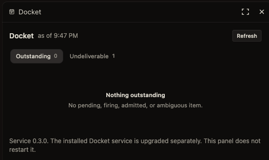

# Docket

<p><a href="assets/workstack-mark-full.png"></a></p>

**Wake an agent session later, without leaving a polling agent running.**

Docket is a bounded local scheduler for OpenCode sessions: timers, alarms,
interval recurrence and built-in watches. It provides a CLI, a loopback HTTP
API and stdio MCP, with SQLite persistence and Python 3.11+ on macOS, Linux and
Windows. The Unix core uses the standard library; Windows also requires
`tzlocal>=5.0` and `tzdata`. An optional OpenChamber panel lists and removes
items; it does not deliver wakes. An optional [Pi companion adapter](docs/pi.md)
targets an existing persistent Pi recipient, with saved-intake-only evidence.
Opt-in Tower notices for fires and new delivery-stall episodes stay off unless
`$DOCKET_TOWER_NATS_URL` is a numeric loopback URL; see [Tower notices](docs/TOWER.md).
That notice does not change delivery, Pi intake, or the limits below.

## Why use Docket?

Many agent harnesses already offer recurring automations. Docket lives outside
the harness: it lets a compatible agent arrange a later wake or check-in during
ongoing work, not just set up recurring routines.

For example, an agent can ask to be woken in 20 minutes to check a download
expected to finish then. Or it can start a background job and arrange a later
check-in, or set a regular reminder. A note in a Markdown file does not wake a
session, and keeping an agent in a model-powered polling loop is unnecessary.

An ad-hoc background polling process can disappear when its harness restarts or
crashes—or be forgotten and left running. Docket keeps schedules in SQLite,
separate from the harness's lifetime, and uses bounded watches and recurrences
rather than forgotten open-ended loops. The CLI gives you one place to inspect
and cancel schedules; the optional panel makes them visible too. Docket must be
running to check or deliver, and the target host must be available and compatible:
persistence is not guaranteed delivery across downtime, and missed recurrence
intervals coalesce rather than all replaying.

Docket schedules the wake, or checks a bounded watch condition, and asks the
host to resume the existing compatible session when due. It does not run the
download or background job itself, and a check-in does not guarantee that work
has finished. Watches still perform periodic checks; they do not keep a model
running. Other harnesses need a compatible delivery adapter, not just Docket
installed alongside them. Codex and Claude Code existing-session wake parity is
not established.

## Quick start

From a stable checkout with Python 3.11+, on macOS or Linux:

```sh
git clone https://github.com/batteryshark/docket.git
cd docket
python3 -m docket --help
python3 -m docket serve
```

On Windows, with Python 3.11+ available as `python`, use PowerShell:

```powershell
git clone https://github.com/batteryshark/docket.git
Set-Location docket
python -m pip install -e .
python -m docket --help
python -m docket serve
```

No dependency installation is needed to run from source on Unix. The Windows
install provisions the declared timezone dependencies and needs pip and Hatchling
build tooling. `serve` starts the **real scheduler**, not a dry run, at
`http://127.0.0.1:8768`; non-loopback binding is refused. Ctrl-C stops it. Do not
run it alongside an installed daemon. Review [host setup](#host-setup) before
scheduling: delivery requires a compatible local host and an existing session.

For an installed `docket` command, optionally use an isolated virtual environment
and `python3 -m pip install -e .` (Windows: `python -m pip install -e .`). The
Unix source launcher `bin/docket` selects an available Python >=3.11;
`DOCKET_PYTHON` can pin its executable. `python3 -m docket` uses the invoked interpreter.
For persistent deployments, use the explicit runtime/root requirements in the
[service runbook](docs/services.md); installation does not copy source or provision
a service runtime.

## Schedule a wake

After host setup, use another terminal. Set `TARGET_SESSION` to an existing
session ID and replace `ITEM_ID` with the ID returned by a create command.
These examples use a Unix shell:

```sh
python3 -m docket timer --in 20m --session "$TARGET_SESSION" --reason "check progress"
python3 -m docket alarm --at 09:00 --session "$TARGET_SESSION" --reason "review"
python3 -m docket recurring --every 15m --count 4 --session "$TARGET_SESSION" --reason "check again"
python3 -m docket list
python3 -m docket occurrences
python3 -m docket cancel "$ITEM_ID"
```

In PowerShell, use `python -m docket`, `$env:TARGET_SESSION` and `$env:ITEM_ID`
instead. For an installed Windows service, use its recorded source root and
venv console interpreter as described in [services](docs/services.md), not a
different Python selected from PATH.

- Recurrence requires `count` (1–100) or an `until` within 90 days, with an
  interval of at least 60 seconds. Missed intervals coalesce rather than replay.
- Watches require `until`. Checks are `file_appears`, `file_stable`,
  `process_ended`, `url_answers` and `session_idle`; see `python3 -m docket watch --help`.
  File stability means a quiet metadata window, not semantic producer completion.
  URL checks have no custom headers and cannot redirect to another origin.
  Process identity must be visible to the daemon; unavailable identity is not exit.
- `--directory` pins the OpenCode target location. Missing, archived or
  wrong-location targets are refused or become undeliverable. An unreadable
  archive overlay is unavailable, not an empty archive.
- Items cannot execute commands or scripts. Context is data, not instructions.
  Ordinary schedules neither reserve model quotas nor dispatch arbitrary worker
  processes or contact the operator directly. A woken agent may act on its own
  instructions; opt-in event handlers have separate installed bounds below.
- Pi selection is explicit per target: `--adapter pi --session pi/<id>`.
  Default OpenCode/paired delivery is unchanged, with no Pi fallback. Read the
  [Pi setup and restrictions](docs/pi.md) first; Pi does not support directory
  pinning or `session_idle` watches, and Docket never launches Pi.

## What delivery means

Normal wakes use `queue` with `resume: true`; urgent wakes use `steer` at a model
step boundary, not mid-token interruption. Queue proof is within the owning
host's active drain; it does not guarantee continuation of an arbitrary multi-step
task or a separate drain.

**Admission is not consumption or execution.** Each occurrence persists a stable
request ID and immutable envelope before sending. OpenCode `delivered` requires
a saved user transcript message with the exact frozen ID and text in the bound
target, not ID-only visibility. Pi requires a consumed / `saved_exact` receipt;
admission, claim and injection are not saved intake, execution or model readiness.
Execution remains unknown; an assistant ACK is separate evidence.

**Possible dispatch is status-only, never a resend.** Missing receipts or lost
visibility remain uncertain, not proof of non-delivery. `failed` is distinct from
`uncertain` and is not permission to create a replacement wake. Only bounded,
core-authorized proven pre-dispatch recovery may reuse the original frozen
ID/body/target, subject to binding and budget checks. Prepared requests cannot
retry after daemon ownership loss, restart or binding change; provider namespace
verification is not established. See [delivery status and recovery](docs/delivery-status.md)
for the exact CLI/HTTP operations, legacy limits and refusal handling. Do not edit
state, rotate identity or use another client/target to bypass a refusal.

An admitted or uncertain occurrence holds the next recurrence until resolved.
A `completed` series does not prove every occurrence was consumed; coalesced
slots are not delivered wakes. Cancel stops the item/series and attempts to
retract the admission, including during sending. Retraction is best-effort: it
cannot undo consumed work, and missing, unreadable, lost or failed-drop outcomes
do not claim undo. Inspect schedule stop and retraction separately; service stop
is not retraction. History and positive facts are retained. Admission-time
lateness may differ from final consumption lateness.

## Host setup

Generic unpaired discovery reads the URL from
`~/.local/state/opencode/service.json`, falling back to `opencode service status`.
It reads the runtime password from that state file or, as a fallback,
`~/.config/opencode/service.json`, using Basic auth with username `opencode`.
The host URL must be loopback; keep these credential files private.

The caller's host must support `POST /api/session/{session_id}/prompt` with a
caller-supplied stable `msg_` ID, `text`, `delivery: queue` or `steer`, and
`resume: true`. Retrying an admitted ID must preserve the original admission
without duplicating it. Reconciliation requires
`GET /api/session/{session_id}/message/{id}` and
`GET /api/session/{session_id}/inbox`; cancellation requires
`DELETE /api/session/{session_id}/inbox/{id}`. Message lookup must distinguish
exact frozen user-message consumption from an item still in the inbox.

Check compatibility on the caller's host before real scheduling. Merely sharing
a transcript database or delivering to an idle session does not prove ownership
of a busy turn. Historical Mac 0.3.0 own-client pairing, delivery, retained items
through Docket-service restart and installed panel relay/removal were accepted;
this does not certify newer source/platform behavior or authorize app restart.

Optional OpenChamber own-client pairing requires explicit operator consent;
follow [PAIRING.md](PAIRING.md). It grants **broad session API access**, not
wake-only permissions. Paired mode uses Docket's own binding and rediscovers
the desktop loopback port. Enrollment latches host selection; missing, expired,
revoked, unreadable or mismatched binding fails without credential borrowing,
old-service or unauthenticated fallback.

The own-record guard is **not host-enforced authentication or capability proof**.
Optional-auth loopback hosts may accept missing/bogus bearers, and a guard/request
race remains. Live revocation is unproven; synthetic refusal tests are not proof.
Do not destroy the last credential to test revocation.

### Optional macOS service

`python3 -m docket service` supports `install`, `start`, `stop`, `restart`,
`status` and `uninstall` for the existing user LaunchAgent. **Mac install starts
the job; never run it alongside `serve`.** Installation pins the running Python
executable and package location, not `bin/docket`. Relocation requires reinstalling.

State defaults to `~/.docket`; `DOCKET_HOME` must resolve to a nonempty absolute
path. `DOCKET_DELIVERY_HOST` accepts `auto` (default), `opencode`,
`openchamber-paired` or `openchamber-unpaired`; enrollment still takes precedence.
The plist persists only PATH, HOME, USER, LOGNAME, resolved DOCKET_HOME and
DOCKET_DELIVERY_HOST, not the whole environment or credentials. Changes require
reinstallation; existing state is not migrated. Stopping prevents delivery;
uninstall does not erase state or history. The [service runbook](docs/services.md)
documents the unchanged Mac canonical-state-alias guard and log locations.

### Linux and Windows services

The same service actions manage a Linux systemd user unit or a Windows per-user
interactive-logon task. Follow the [platform service runbook](docs/services.md)
for explicit persistent source/runtime selection, private storage, logs, individual
lifecycle commands and retained state. Linux install enables/starts the unit;
Windows install registers but does **not** start the task. Windows requires the
recorded venv console `python.exe` for manual CLI calls and `pythonw.exe` for
the scheduled daemon. A changed deployment is refused, not silently upgraded;
uninstall retains the Windows manifest, including its reconfiguration restrictions.

Docket does not manage the agent host. The runbook includes separate, optional
OpenCode startup recipes: Linux boot availability depends on existing user-manager/
linger policy; Windows requires interactive logon, not a logged-out boot service.
Native Linux reboot with automatic services and a retained timer wake/ACK was
accepted. Actual Windows logon automatically started both services and the
original retained watch produced exact saved intake and a completed tool-free ACK.
Windows OS reboot was **not separately tested**. These are bounded demonstrations,
not universal availability or task-execution guarantees. Pi saved intake does not
prove Pi startup, unattended availability, authentication or model readiness.

## Opt-in event delivery

Authenticated event intake now feeds a durable subscription queue with dedupe,
bounded backoff, dead letters and inspection. Installed versioned profiles can
only narrow an installed native baseline: identity, tools, authority, secrets
references, model and budget are operator configuration, never event-selected.
Event fields are bounded, delimited data, not instructions. Actions can wake an
explicitly provisioned existing owner or run a fresh scoped handler with
revoke-first automatic cleanup. Enrollment requires an actual installed native
baseline, role, goal and hooks; it does not attach to existing principal leads.

See [native profiles and operator setup](integrations/opencode/README.md),
[handler requirements](integrations/opencode/sandbox-runtime.md) and the
[write-only journal](integrations/toolstack/event-journal/README.md). Events are
off unless explicit private configs are supplied; ordinary schedules are unchanged.
Inspection uses the existing admin bearer, not the publisher/channel credential:

```sh
python3 -m docket events list --json
python3 -m docket events deadletters --json
python3 -m docket events inspect evd_… --json
python3 -m docket events outcomes --json
```

Both native actions and handler token/caller revocation and pruning were exercised;
the normal live scheduler also completed one journal-only handler. The exercised
hard-cap route is `xai/grok-4.7` over HTTP. The installed live class only records
a bounded journal summary. The native handler backend requires macOS Seatbelt,
Fleet and compatible OpenCode; this is not universal provider/platform support.
Real Tool Stack/Nod pending/refusal contracts are proved, not a principal approval.
Risky capabilities require separately authorized installed scopes and real review;
missing approval machinery fails closed. The scoped own-milestone helper is also
native-bound; it does not grant generic roster writes or reenrollment.

## API, MCP and private state

### Current work — 22 October 2026

Opt-in [lead check-ins](LEAD_CHECKINS.md) add observed-idle and explicit-milestone
nudges through bounded owned watches. Missing private roster means off; one-line
hold/done controls and the existing four-eligible-pair capacity apply. Check-ins
have source tests and a recorded macOS activation, but automatic consumed-wake
proof remains pending; Windows/Linux check-in compatibility is not established.
The accepted cross-platform core and Pi restrictions above are unchanged.

[Subscription intake, API/config, admission/worker and native runtime modules,
plus the scoped own-row milestone helper](docs/current-work.md), are now wired
through explicit opt-in configuration and native bindings. Publishing source does
not install those configs, enroll owners or automatically enable delivery.

API reads are local; mutations require the Docket bearer token. Metadata is at
`GET /api/v1/meta`, with listings at `/api/v1/items` and `/api/v1/occurrences`.
Pending listings include firing, admitted and ambiguous states. Lifecycle and
delivery outcome are separate; see [delivery status](docs/delivery-status.md) for
filters, status-only reconciliation and conservative retry. Compact panel history
is bounded and may be truncated or unavailable, not an exhaustive audit.

`python3 -m docket mcp` exposes stdio JSON-RPC tools for creating, listing and
cancelling schedules through the running API; it does not register itself in
host configuration. There are no MCP reconcile/retry tools. `DOCKET_URL` and
`DOCKET_TOKEN` override discovery; protect them as private configuration.
See [AGENT_USAGE.md](AGENT_USAGE.md) for host-neutral setup and usage rules;
these examples are not permission to change global prompts or host settings.

`~/.docket/` on macOS/Linux, or `%LOCALAPPDATA%\Docket` on Windows, holds SQLite,
token, server metadata and private records; log locations vary by backend.
Pairing adds private binding/enrollment records. POSIX state is owner-only;
Windows uses native private storage guards without ACL repair. `DOCKET_HOME`
selects a different private root, not a migration. Keep state out of source control.
Back up SQLite consistently (including WAL semantics), preserve bindings and service
records, and never copy an old database over a live one: it can discard history or
replay stale work. Do not let an old writer retry newer immutable-request state.
Recovery requires coordinated, stopped-service review. The optional archive overlay
is read, never modified; an unreadable overlay is not treated as no archived sessions.

## Optional OpenChamber panel



Genuine panel screenshot: **0 outstanding, 1 undeliverable**, not an
empty healthy scheduler. The service upgrades separately; the panel does not
restart it. This is not proof of delivery, pairing, restart or packaged-extension
acceptance.

The [panel source and built JavaScript](openchamber/README.md) are included.
Historical Mac acceptance included visual approval and installed host-route
relay/removal, not UI-click automation or current platform certification. The
relay keeps the Docket API token server-side, never in the iframe; the panel does
not deliver wakes. Any installation is a separate principal-managed action.

## Known limitations

Do not run full test discovery, browser/CDP, e2e or evidence scripts: a browser
updater escaped an earlier isolation attempt. Browser test sources remain for
containment review. The historical browser-era suite was not green; no full-suite
acceptance is claimed. This documentation authorizes no new live validation.

Historical Mac acceptance and bounded Linux/Windows lifecycle evidence are not
universal delivery guarantees. Real revocation remains unproven. The optional
Pi route proves saved intake only, not execution, authentication, busy-steer
integration or unattended availability; see its [specific limits](docs/pi.md).
Codex and Claude Code existing-session wake parity is not established.

## License and artwork

Original principal-owned code and documentation are [MIT licensed](LICENSE).
The existing comic marks are **AI-generated artwork**, also offered under MIT
to the extent applicable, without a claim of exclusive copyright in AI output.
The [32px mark](assets/workstack-mark-32.png) is a separate composition, not a
downscaled badge. See [RIGHTS.md](RIGHTS.md) for asset scope and outside notices.
